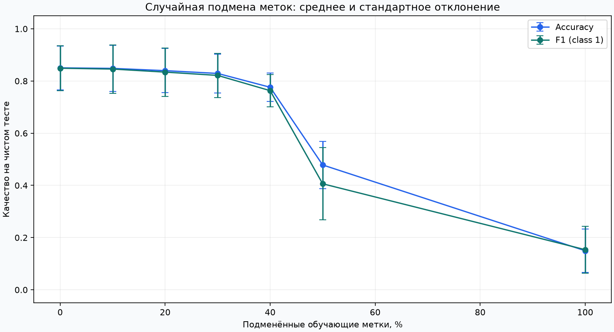
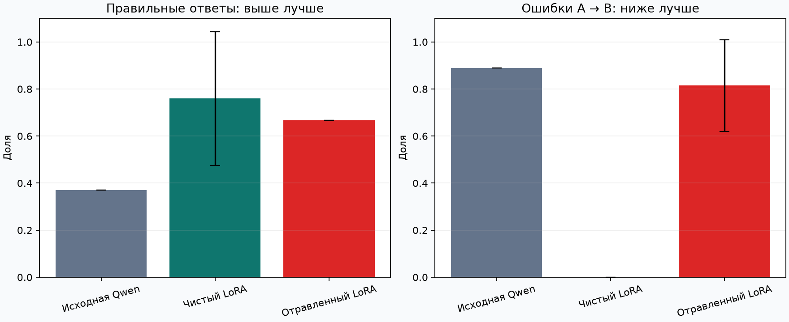

# ML Poisoning Lab

Локальная лаборатория: как подмена правильных ответов в обучающих данных влияет на
бинарный классификатор. Только синтетические данные, CPU и воспроизводимые эксперименты.



**Сценарий:** обучить чистую модель → подменить часть обучающих меток → заново обучить
такую же модель → измерить качество на том же чистом тесте. Результаты сохраняются
в JSON, PNG и самодостаточный HTML-отчёт, который открывается без интернета.

## Быстрый запуск

Нужны Python 3.11–3.14 и [uv](https://docs.astral.sh/uv/). Для разработки выбран Python 3.13.
Первый запуск загружает зависимости; сам эксперимент к сети не обращается.

```bash
uv sync --locked
uv run --frozen ml-poisoning-lab
```

Открой `results/report.html` в браузере. Рядом появятся `results.json` и `poisoning.png`.
Повторный запуск в тот же каталог перезаписывает эти три файла.

Для собственного эксперимента:

```bash
uv run --frozen ml-poisoning-lab --samples 3000 --repeats 10 --seed 100 --fractions 0 0.1 0.25 0.5 1 --output results/custom
```

Точка 0 обязательна: это чистая модель для сравнения. Минимум 100 примеров и 2 повтора.
Точный бюджет округляется вниз до целого числа строк и записывается в JSON.

## Что здесь происходит

**Признаки** — числа, по которым модель делает предсказание. **Метка** — правильный
ответ 0 или 1. Атака оставляет признаки прежними, но меняет выбранные ответы на противоположные.

**Обучающая выборка** нужна для обучения. **Тестовая выборка** заранее откладывается
для проверки и остаётся чистой. Если испортить и тестовые ответы, эксперимент начнёт
проверять согласованность с ложными ответами вместо качества на исходной задаче.

**Baseline** — та же модель без атаки. **Seed** задаёт повторяемую последовательность
случайных действий. Внутри повтора выборки фиксированы; больший бюджет подмен продолжает
тот же случайный список индексов. Между повторами меняются данные и случайный выбор.

Модель — логистическая регрессия после StandardScaler. Масштабирование обучается только
на train через Pipeline. Отложенная выборка не участвует в обучении или подборе параметров.

## Как читать результат

Accuracy — доля правильных ответов. F1 учитывает precision и recall для класса 1.
В отчёте указаны среднее и стандартное отклонение по повторам, а также изменение
относительно чистой модели того же повтора. Разброс не является доверительным интервалом.

Небольшая случайная подмена может почти не ухудшить качество. Мы не подгоняем данные
и не требуем красивой монотонной кривой. Бюджет 100% — контрольная крайность,
позволяющая проверить полную инверсию задачи, а не реалистичный сценарий атаки.

В сохранённом запуске с параметрами по умолчанию средняя accuracy по пяти повторам:

| Подменённые метки | Accuracy | Изменение к чистой модели |
|---|---|---|
| 0% | 85,0% | 0 п.п. |
| 10% | 84,8% | −0,20 п.п. |
| 40% | 77,6% | −7,43 п.п. |
| 50% | 47,8% | −37,20 п.п. |
| 100% | 15,0% | −70,07 п.п. |

Числа округлены для чтения. [Полные измерения](examples/default/results.json)
и [HTML-отчёт](examples/default/report.html) сохранены вместе с графиком.

[Подробная методика, модель угроз и ограничения](docs/methodology.md).

## Проверка

```bash
uv run --frozen pytest
uv run --frozen ruff check .
```

Тесты проверяют подмену, воспроизводимость, изоляцию тестовой выборки и запуск CLI
с созданием артефактов. Их задача — проверить корректность эксперимента; падение
качества само по себе не является условием прохождения тестов.

## Структура

```text
src/ml_poisoning_lab/
  poisoning.py     # подмена меток
  experiment.py    # данные, обучение и парные измерения
  report.py        # график и HTML/JSON
  cli.py           # интерфейс командной строки
tests/             # проверки контрактов и методики
docs/              # модель угроз и ограничения
examples/          # сохранённый демонстрационный запуск
```

## Статус и дальнейшие шаги

### Эксперимент с Qwen

Дополнительный режим для Mac с Apple Silicon: настоящее LoRA-дообучение
`Qwen/Qwen3-0.6B` на вымышленных заявках в техподдержку. Сравниваются исходная
модель, чистое дообучение и подмена сетевых ответов A→B в обучающей выборке.
Зависимости MLX отделены от первоначальной лаборатории.

```bash
uv sync --locked --extra qwen
uv run --frozen --extra qwen qwen-poisoning-lab --output artifacts/qwen-v1
```

Первый запуск скачивает около 1,5 ГБ официальных весов. Веса, адаптеры и служебные
логи остаются в `artifacts/`, исключённом из Git. Для каждого нового запуска нужен
новый выходной каталог. Кэш моделей используется повторно.

Создание отчёта после завершения всех этапов:

```bash
uv run --frozen --extra qwen python -m ml_poisoning_lab.qwen.report artifacts/qwen-v1/results.json --output results/qwen-v1
```

[Зафиксированная методика Qwen](docs/qwen-methodology.md): данные, бюджет атаки,
настройки обучения, оценка и ограничения. Это один небольшой синтетический сценарий,
не оценка безопасности всех Qwen или корпоративных установок.

Финальный запуск: три парных повтора по 1000 шагов. Средняя accuracy изменилась
с 75,9% до 66,7%, а доля ошибочных переходов «сеть → учётная запись» — с 0% до 81,5%.
Чистые адаптеры чувствительны к seed: accuracy от 44,4% до 100%. В одном повторе
общая accuracy после атаки выросла, хотя сетевые заявки стали уходить в неверную очередь.



- [Все измерения и протокол финального запуска](examples/qwen-v3/README.md).
- [Черновик статьи для Codeby](docs/article-qwen.md).
- [BBCode и подготовка к переносу на Codeby](docs/codeby-publishing.md).

На Codeby ничего не опубликовано; код и статья пока хранятся в приватном репозитории.

### Первоначальная лаборатория

Версия 0.1: случайная подмена меток, одна модель, один генератор синтетических данных.
Механизмы защиты пока не реализованы. Следующий этап — отдельная validation-выборка
и эксперимент с контролем целостности данных или небольшой доверенной выборкой.
Синтетический эксперимент не доказывает эффективность атаки или защиты в реальной системе.

Проект создаётся с помощью AI: agy с Claude Sonnet подготовил основу функции подмены;
Codex проверил и адаптировал её, реализовал эксперимент, отчёт и независимые тесты.
Наличие проекта не означает самостоятельного выполнения всех этапов его владельцем.
