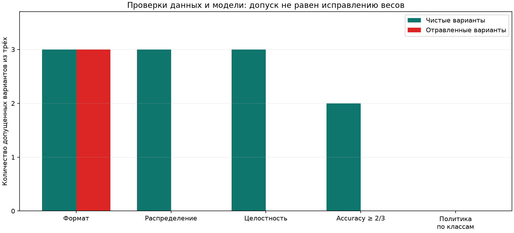

# Проверка защит

Использованы шесть сохраненных адаптеров `qwen-v3`, без изменения весов и нового обучения.
36 новых доверенных контрольных заявок: три шаблона на класс, четыре варианта каждого.
Это небольшой коррелированный набор; пороги выбраны после знакомства с атакой,
но зафиксированы до получения ответов на новые заявки. Пороги не подбирались повторно.

| Проверка | Пропущено чистых из 3 | Пропущено отравленных из 3 |
|---|---:|---:|
| Формат меток A/B/C | 3 | 3 |
| Сохранение распределения меток | 3 | 0 |
| Целостность относительно доверенного эталона | 3 | 0 |
| Общая accuracy ≥ 2/3 | 2 | 0 |
| Accuracy + recall каждого класса ≥ 75%, A→B ≤ 10%, invalid = 0 | 0 | 0 |

Первые три строки относятся к кандидатам обучающих данных. Последние две показывают
повторную проверку допуска уже обученных адаптеров. Отказ не исправляет веса.
Никакой «точности защищенной модели» или эффекта резервной модели здесь не измерялось.
Исходный runner обучения автоматически не включает эти проверки: это отдельный эксперимент.

Гистограмму обошел контрольный обмен 27 A→B и 27 B→A: распределение прежнее,
но контроль целостности обнаружил 54 изменения. Этот контроль не дообучался;
его эффект на ответы модели не проверялся. Перестановка чистых строк принимается.
Если доверенным эталоном изначально объявить испорченные данные, проверка пропускает их.
Хеширование не проверяет правильность исходной разметки и не заменяет подпись или ACL.

Строгий допуск отверг все чистые адаптеры, у которых на контрольном наборе действительно
были провалы отдельных классов. Поэтому нельзя объявить его лучшим решением или
приписать все отказы ложным срабатываниям детектора poisoning. Это политика качества,
а не средство установить причину ошибки. В этой партии простая accuracy уже отклонила
все отравленные адаптеры; дополнительного обнаружения строгая политика не дала.

[results.json](results.json) содержит все 216 новых ответов, причины решений и контрольные случаи.
[plan.json](plan.json) и [canary.json](canary.json) сохранены до генерации. Метрики независимо сверены со sklearn.

Из корня проекта, если локальные адаптеры `artifacts/qwen-v3` сохранены:

```bash
uv run --frozen --extra qwen python -m ml_poisoning_lab.qwen.defenses --output artifacts/defense-reproduction
```

Для другого пути адаптеров доступен `--artifacts`. Официальные веса должны быть в
локальном кэше проекта с той же ревизией. Одного клона Git недостаточно: веса и
адаптеры в репозиторий не включены; их нужно получить запуском исходного эксперимента.



[Исходный эксперимент](../qwen-v3/README.md) · [Статья](../../docs/article-qwen.md) · [На главную](../../README.md)
